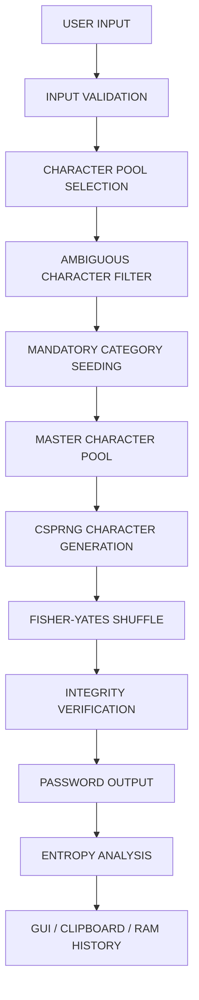
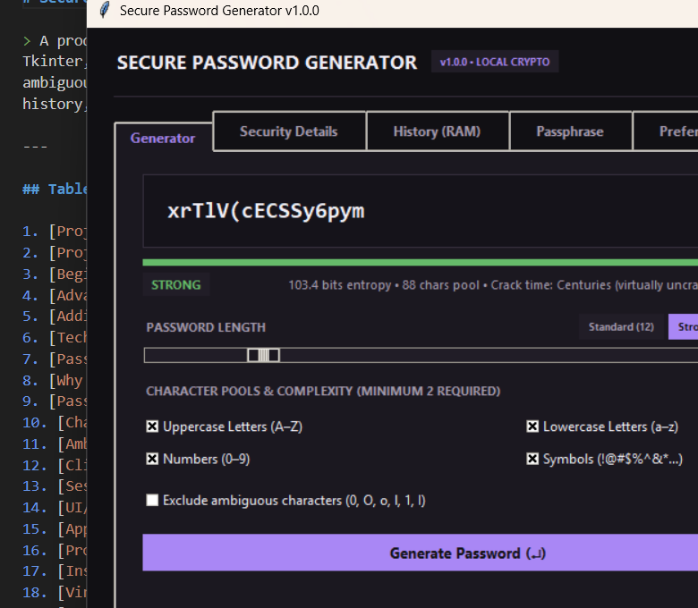
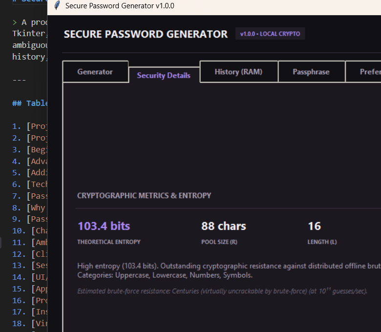
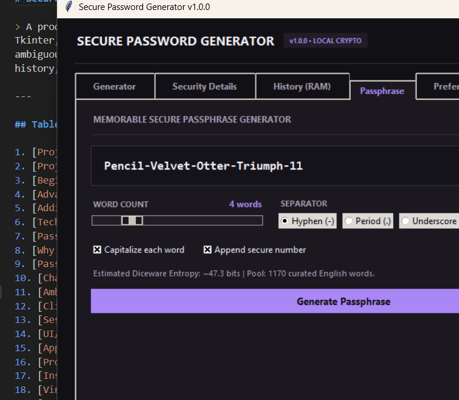
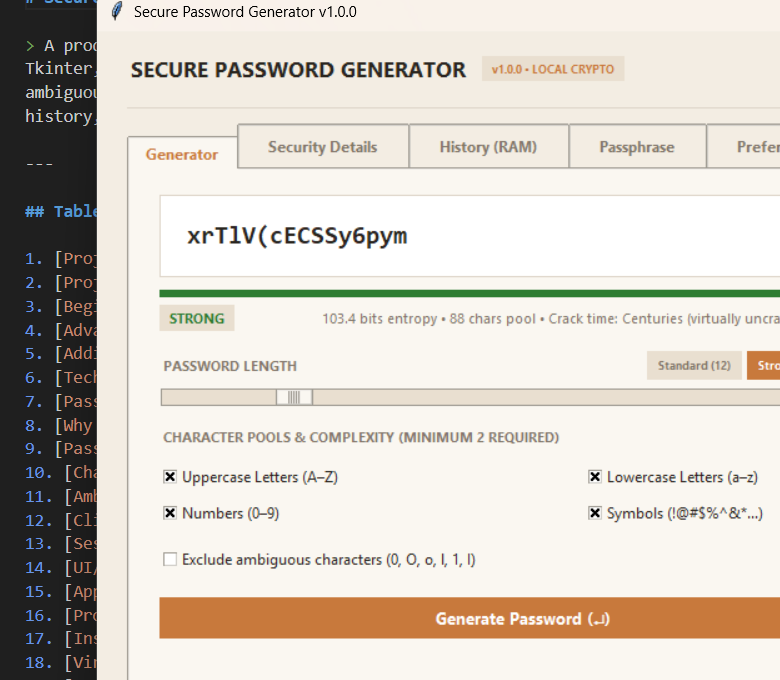
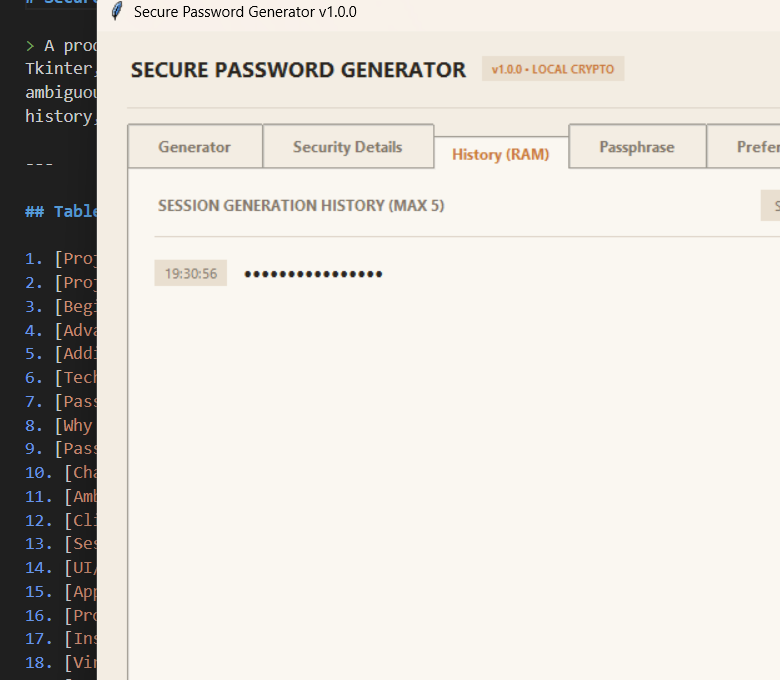

<div align="center">

# ⬡ SECURE PASSWORD GENERATOR

### CRYPTOGRAPHICALLY SECURE · PRIVACY-FIRST · OFFLINE

**Generate Strong. Stay Secure. Own Your Data.**

<br/>


<br/>

[](https://www.python.org/)
[]()
[]()
[]()
[]()
[]()

<br/>


</div>

---

<div align="center">

## ◈ PROJECT OVERVIEW

</div>

**Secure Password Generator** (`ArnavSharma_Task3`) is a cryptographically secure desktop password generation utility engineered using Python, Tkinter, and the standard library's `secrets` module.

Moving beyond conventional random string generators, this application combines operating-system-backed cryptographic randomness, mandatory character-category representation, real-time Shannon entropy analysis, ambiguous character filtering, and secure passphrase generation.

The application operates completely offline, without cloud services, external APIs, account creation, or telemetry.

### Core Philosophy

| Principle | Implementation |
|:---|:---|
| Cryptographic Security | OS-backed CSPRNG through Python `secrets` |
| Mathematical Transparency | Real-time entropy calculation |
| Privacy | Passwords remain in volatile memory |
| Usability | Desktop GUI with keyboard shortcuts |
| Accessibility | Password masking and ambiguous character filtering |
| Flexibility | Custom generation presets and passphrases |

---

## ◈ 01 — FEATURE OVERVIEW

<div align="center">

### Built for Security. Designed for Simplicity.

</div>

| Feature | Description |
|:---|:---|
| Password Generation | Cryptographically secure password generation |
| Custom Length | Adjustable password length from 8 to 128 characters |
| Character Selection | Uppercase, lowercase, numbers and symbols |
| Category Guarantee | Every selected category appears at least once |
| Strength Meter | Real-time Weak, Medium and Strong classification |
| Shannon Entropy | Mathematical password entropy calculation |
| Clipboard Integration | Manual and automatic password copying |
| Ambiguous Filtering | Excludes confusing characters |
| Session History | Stores the latest 5 passwords in RAM |
| Password Masking | Show/hide password functionality |
| Password Presets | Standard, Strong and Maximum presets |
| Diceware Passphrases | Secure memorable multi-word passphrases |
| Theme Switching | Light and Dark visual identities |
| Keyboard Shortcuts | Quick generation and application controls |
| Preferences | Saves non-sensitive user settings |

---

## ◈ 02 — BEGINNER TIER FEATURES

All foundational requirements are implemented.

- [x] Interactive password length selection.
- [x] Minimum password length of 8 characters.
- [x] Maximum configurable length of 128 characters.
- [x] Uppercase character selection.
- [x] Lowercase character selection.
- [x] Numeric character selection.
- [x] Special symbol selection.
- [x] Minimum two active character categories.
- [x] Guaranteed presence of every selected category.
- [x] Exclusion of unselected character categories.
- [x] Exact requested password length.
- [x] Instant password regeneration.
- [x] Input validation and friendly error messages.

---

## ◈ 03 — ADVANCED TIER FEATURES

- [x] Modern Tkinter and ttk desktop interface.
- [x] Cryptographically secure `secrets` module.
- [x] Real-time password strength evaluation.
- [x] Shannon information entropy calculation.
- [x] Visual password strength indicator.
- [x] Clipboard integration using `pyperclip`.
- [x] Automatic clipboard copying.
- [x] Ambiguous character exclusion.
- [x] Five-entry in-memory session history.
- [x] Password masking and visibility toggle.
- [x] Volatile RAM-only password history.
- [x] Offline-first execution.
- [x] Persistent non-sensitive UI preferences.

---

## ◈ 04 — ADDITIONAL CREATIVE FEATURES

### 1. Password Presets

| Preset | Password Length |
|:---|:---:|
| Standard | 12 Characters |
| Strong | 16 Characters |
| Maximum | 24 Characters |
| Custom | User Defined |

### 2. Diceware Passphrase Generator

Generate memorable, cryptographically secure passphrases using a curated English wordlist.

Features include:

- Customizable word count from 3 to 8.
- Multiple separators: `-`, `.`, `_`, and spaces.
- Capitalization options.
- Optional secure numeric suffixes.
- Cryptographically secure word selection.

### 3. Entropy Diagnostics

The application provides an educational breakdown of:

- Character pool size.
- Password length.
- Theoretical entropy in bits.
- Password strength classification.
- Estimated offline brute-force duration.

### 4. Non-Sensitive Preferences

The application remembers:

- Selected theme.
- Default password length.
- Character category preferences.
- Ambiguous character exclusion.
- Auto-copy preference.
- Password visibility preference.

Generated passwords are never included in the preferences file.

---

## ◈ 05 — TECHNOLOGY STACK

<div align="center">


</div>

| Component | Technology | Purpose |
|:---|:---|:---|
| Programming Language | Python 3.10+ | Application logic |
| Cryptographic Engine | `secrets` | Secure random generation |
| GUI Framework | Tkinter + ttk | Desktop interface |
| Clipboard | pyperclip | Clipboard operations |
| Image Handling | Pillow | Image utilities |
| Testing | pytest | Automated testing |
| Packaging | PyInstaller | Standalone executable |
| Configuration | JSON | Non-sensitive preferences |

---

## ◈ 06 — 3D CRYPTOGRAPHIC ARCHITECTURE

<div align="center">

### Secure Generation Pipeline

</div>



### Architectural Components

| Layer | Responsibility |
|:---|:---|
| Presentation Layer | Tkinter interface, controls and visual feedback |
| Generation Layer | Cryptographic password and passphrase generation |
| Security Layer | Entropy analysis and category validation |
| Service Layer | Clipboard and settings management |
| Utility Layer | Input validation and helper functions |
| Testing Layer | Unit and integration testing |

---

## ◈ 07 — PASSWORD GENERATION METHODOLOGY

The application follows a structured cryptographic generation pipeline.

### Step 1 — Input Validation

Validates:

- Requested password length is at least 8.
- Maximum configured length is 128.
- At least two character categories are enabled.
- Every active character pool contains valid characters.

### Step 2 — Ambiguous Character Filtering

When enabled, the following characters are excluded:

`0 O o l 1 I`

### Step 3 — Mandatory Category Seeding

One character is securely selected from each enabled category using:

```python
secrets.choice(character_pool)
```

This guarantees that all selected character categories appear at least once.

### Step 4 — Master Pool Combination

All active character pools are combined into a unified character pool.

### Step 5 — Remaining Character Generation

The remaining positions are populated using cryptographically secure selection:

```python
secrets.choice(master_pool)
```

### Step 6 — Cryptographic Shuffling

The generated characters are shuffled using Fisher-Yates with `secrets.randbelow()`.

```python
secrets.randbelow(i + 1)
```

### Step 7 — Integrity Verification

The final password is checked for:

- Exact requested length.
- Mandatory category representation.
- Exclusion of disabled categories.
- Absence of forbidden ambiguous characters.

---

## ◈ 08 — WHY `secrets` INSTEAD OF `random`?

One of the most important engineering decisions in this project is the use of Python's `secrets` module instead of the conventional `random` module.

### Python `random`

- Uses the deterministic Mersenne Twister algorithm.
- Designed for simulation and general-purpose randomness.
- Internal state can be reconstructed under appropriate observation conditions.
- Not suitable for generating security-sensitive credentials.

### Python `secrets`

- Designed specifically for security-sensitive randomness.
- Uses operating-system cryptographic randomness sources.
- Provides cryptographically secure selection.
- Suitable for generating passwords, tokens and authentication secrets.

### Operating System Entropy Sources

| Operating System | Randomness Source |
|:---|:---|
| Windows | BCryptGenRandom |
| Linux | getrandom() / `/dev/urandom` |
| macOS | getentropy() |

Python's `secrets` module delegates secure randomness to the operating system.

**Security decision:** The application exclusively uses `secrets` for password character selection and secure shuffling. It does not use `random` for credential generation.

---

## ◈ 09 — PASSWORD STRENGTH & SHANNON ENTROPY

The application estimates password strength using theoretical information entropy.

### Mathematical Formulation

\[
E = L \times \log_2(R)
\]

Where:

- \(E\) = Theoretical entropy in bits.
- \(L\) = Password length.
- \(R\) = Number of available characters in the combined pool.

### Strength Classification

| Entropy | Classification | Indicator |
|:---:|:---|:---:|
| Below 40 bits | Weak | Low |
| 40–59.9 bits | Medium | Moderate |
| 60 bits and above | Strong | High |

### Example

Consider a password generated using:

- Length: 16 characters.
- Character pool: 82 possible characters.

\[
E = 16 \times \log_2(82)
\]

\[
E \approx 101.69 \text{ bits}
\]

This represents the theoretical search-space entropy under the application's character-selection assumptions.

> **Security disclaimer:** Entropy is an estimate, not a guarantee of absolute security. Actual password security also depends on generation assumptions, password handling, implementation details, and the attacker's knowledge.

---

## ◈ 10 — CHARACTER CATEGORIES

| Category | Characters | Total |
|:---|:---|:---:|
| Uppercase | A–Z | 26 |
| Lowercase | a–z | 26 |
| Numbers | 0–9 | 10 |
| Symbols | `!@#$%^&*()_+-=[]{}|;:,.<>?` | 26 |
| **Total** | **Combined character pool** | **88** |

### With Ambiguous Characters Excluded

| Category | Remaining Characters |
|:---|:---:|
| Uppercase | 24 |
| Lowercase | 24 |
| Numbers | 8 |
| Symbols | 26 |
| **Total** | **82** |

---

## ◈ 11 — AMBIGUOUS CHARACTER EXCLUSION

Certain characters can be difficult to distinguish in common fonts.

Examples:

| Character | Potential Confusion |
|:---|:---|
| `0` | Capital O / lowercase o |
| `O` | Digit zero |
| `o` | Capital O |
| `1` | Lowercase l / capital I |
| `l` | Digit one |
| `I` | Lowercase l |

When the exclusion option is enabled, the application removes:

```python
"0Ool1I"
```

from the active character pools before password generation.

The application also verifies that the resulting pools remain valid.

---

## ◈ 12 — CLIPBOARD INTEGRATION

Clipboard functionality is implemented using `pyperclip`.

### Available Operations

- Manual password copying.
- Automatic copying after generation.
- Copying passwords from session history.
- Error handling for unavailable clipboard access.
- User feedback through notifications.

**Security consideration:** Passwords copied to the operating-system clipboard may remain available through clipboard history or other clipboard-monitoring software. Users should clear sensitive clipboard contents when appropriate.

---

## ◈ 13 — SESSION HISTORY & RAM PRIVACY

The application includes a temporary session history manager.

### History Capabilities

- Stores the latest 5 generated passwords.
- Displays timestamps.
- Shows password strength indicators.
- Supports previewing and copying historical entries.
- Automatically removes the oldest entry when a sixth password is generated.

### Privacy Architecture

<details>
<summary><b>▶ How Password Storage Works</b></summary>

| Storage Location | Passwords Stored? |
|:---|:---:|
| Application RAM | Yes, temporarily |
| SQLite Database | No |
| JSON Configuration | No |
| Text Files | No |
| Application Logs | No |
| Temporary Disk Files | No |

The session history is maintained exclusively in volatile memory and is cleared when the application exits.

</details>

---

## ◈ 14 — UI/UX DESIGN PHILOSOPHY

The application follows a Scandinavian-inspired minimalist design system.

### Visual Principles

- Open-canvas layout.
- Generous whitespace.
- Thin structural dividers.
- Minimal visual clutter.
- Typography-led hierarchy.
- Monospace password presentation.
- Clear visual feedback.
- Consistent interactive elements.

### LIGHT MODE — Warm Beige & Burnt Orange

| Element | Color |
|:---|:---|
| Background | `#F3EDE3` |
| Surface | `#FAF7F1` |
| Secondary Surface | `#E9DFD0` |
| Primary Accent | `#C8793C` |
| Muted Accent | `#B96C32` |
| Primary Text | `#29251F` |
| Secondary Text | `#81776A` |
| Borders | `#DED5C9` |

### DARK MODE — Near Black & Soft Violet

| Element | Color |
|:---|:---|
| Background | `#111014` |
| Surface | `#1B1820` |
| Secondary Surface | `#211D27` |
| Primary Accent | `#A987F5` |
| Muted Accent | `#8A66D6` |
| Primary Text | `#F2EFF7` |
| Secondary Text | `#A69BAF` |
| Borders | `#37303F` |

### Keyboard Shortcuts

| Shortcut | Action |
|:---|:---|
| Enter | Generate password / passphrase |
| Ctrl + C | Copy current password |
| Ctrl + T | Toggle theme |
| Ctrl + H | Show / Hide password |
| F5 | Regenerate password |

---

## ◈ 15 — APPLICATION SCREENSHOTS

<div align="center">

### Dark Mode — Main Generator



### Dark Mode — Cryptographic Security & Entropy



### Dark Mode — Passphrase Generator



### Light Mode — Password Generator



### Light Mode — Session History



</div>

---

## ◈ 16 — PROJECT DIRECTORY STRUCTURE

```text
ArnavSharma_Task3/
│
├── main.py
├── config.py
├── password_generator.py
├── password_strength.py
├── clipboard_service.py
├── requirements.txt
├── README.md
├── .gitignore
│
├── modules/
│   ├── __init__.py
│   ├── generator_ui.py
│   ├── security_details.py
│   ├── history_ui.py
│   ├── passphrase_ui.py
│   └── settings_ui.py
│
├── services/
│   ├── __init__.py
│   ├── generation_service.py
│   ├── clipboard_service.py
│   └── settings_service.py
│
├── themes/
│   ├── __init__.py
│   ├── light.py
│   ├── dark.py
│   └── theme_manager.py
│
├── utils/
│   ├── __init__.py
│   ├── validators.py
│   ├── helpers.py
│   └── wordlist.py
│
├── tests/
│   ├── __init__.py
│   ├── test_generator.py
│   ├── test_strength.py
│   ├── test_validation.py
│   ├── test_clipboard.py
│   ├── test_history.py
│   └── test_passphrase.py
│
├── scripts/
│   └── capture_screenshots.py
│
└── assets/
    └── screenshots/
        ├── dark_mode_generator.png
        ├── dark_mode_security.png
        ├── dark_mode_passphrase.png
        ├── light_mode_generator.png
        └── light_mode_history.png
```

---

## ◈ 17 — INSTALLATION PREREQUISITES

- Python 3.10 or higher.
- Windows 10 / Windows 11 recommended.
- Official Python installation with Tkinter support.
- pip package manager.

---

## ◈ 18 — VIRTUAL ENVIRONMENT SETUP

Open PowerShell in the repository directory.

### Create Virtual Environment

```powershell
python -m venv .venv
```

### Activate Environment

```powershell
.\.venv\Scripts\Activate.ps1
```

Alternatively, using Command Prompt:

```cmd
.venv\Scripts\activate.bat
```

---

## ◈ 19 — DEPENDENCY INSTALLATION

Install the required packages:

```powershell
python -m pip install --upgrade pip

pip install -r requirements.txt
```

---

## ◈ 20 — RUNNING THE APPLICATION

Launch the desktop application:

```powershell
python main.py
```

The application opens its desktop interface with the saved user preferences and default generation settings.

---

## ◈ 21 — CONFIGURATION & PREFERENCES

The application stores non-sensitive preferences in:

```text
~/.secure_password_generator/
└── secure_password_generator_settings.json
```

### Example Configuration

```json
{
  "theme": "dark",
  "default_length": 16,
  "include_uppercase": true,
  "include_lowercase": true,
  "include_numbers": true,
  "include_symbols": true,
  "exclude_ambiguous": false,
  "auto_copy": false,
  "mask_password": false
}
```

**Important:** Generated passwords and session history are never saved in this configuration file.

---

## ◈ 22 — AUTOMATED TESTING & QUALITY ASSURANCE

<div align="center">


### Comprehensive Testing Coverage

</div>

Run the automated test suite:

```powershell
pytest -v
```

### Test Coverage

| Test Suite | Coverage |
|:---|:---|
| Generator | Length, category guarantees, exclusions |
| Strength | Entropy calculations and classifications |
| Validation | Input types and boundaries |
| Clipboard | Copy operations and error handling |
| History | RAM lifecycle and five-entry limit |
| Passphrase | Word selection and generation |

### Testing Highlights

- Exact password length verification.
- Character category representation across repeated generations.
- Strict exclusion of disabled categories.
- Ambiguous character filtering.
- Entropy calculation verification.
- Clipboard exception handling using mocks.
- Session history lifecycle validation.
- Passphrase generation validation.

<badge color="success">52 automated tests reported passing</badge>

---

## ◈ 23 — PYINSTALLER STANDALONE PACKAGING

Generate a standalone Windows executable:

```powershell
pyinstaller --name "SecurePasswordGenerator" --onefile --windowed --noconfirm main.py
```

The executable is generated inside:

```text
dist/
└── SecurePasswordGenerator.exe
```

This allows the application to run on compatible Windows systems without requiring a separate Python installation.

---

## ◈ 24 — SECURITY CONSIDERATIONS & THREAT MODEL

| Potential Threat | Mitigation |
|:---|:---|
| Predictable RNG State | OS-backed CSPRNG through `secrets` |
| Biased Shuffling | Fisher-Yates with `secrets.randbelow()` |
| Shoulder Surfing | Password visibility masking |
| Data-at-Rest Exposure | No persistent password storage |
| Clipboard Snooping | Clipboard usage warnings |
| Cloud Data Leakage | Offline-first architecture |
| Invalid User Input | Strict input validation |
| Password History Exposure | Volatile RAM-only history |

### Security Limitations

Although the application follows cryptographic best practices, some limitations remain:

- Clipboard contents may be retained by the operating system.
- Passwords temporarily exist in application memory.
- Python does not guarantee secure zeroization of all immutable string objects.
- Entropy estimates do not account for every possible implementation or attack weakness.
- The security of the application also depends on the security of the host operating system.

---

## ◈ 25 — TROUBLESHOOTING

<details>
<summary><b>▶ No module named '_tkinter'</b></summary>

Ensure that Python was installed with Tcl/Tk support. Use an official Python installer with the appropriate optional components.

</details>

<details>
<summary><b>▶ Clipboard is not working</b></summary>

On Linux, install the required clipboard utility:

```bash
sudo apt install xclip
```

Alternatively, install `xsel` through your package manager.

</details>

<details>
<summary><b>▶ PowerShell execution policy error</b></summary>

Run:

```powershell
Set-ExecutionPolicy -Scope Process -ExecutionPolicy Bypass
```

Then activate the virtual environment again.

</details>

---

## ◈ 26 — FUTURE ENHANCEMENTS

| Enhancement | Status |
|:---|:---:|
| System Tray Integration | Planned |
| Custom Symbol Subsets | Planned |
| Automatic Clipboard Clearing | Planned |

---

## ◈ 27 — FEATURE CHECKLIST

### Beginner Tier

- [x] Password length selection.
- [x] Minimum 8-character enforcement.
- [x] Input validation.
- [x] Uppercase, lowercase, number and symbol selection.
- [x] Minimum two-category policy.
- [x] Mandatory category representation.
- [x] Exact password length.
- [x] Password regeneration.

### Advanced Tier

- [x] Tkinter desktop GUI.
- [x] Cryptographically secure `secrets` generation.
- [x] Fisher-Yates secure shuffling.
- [x] Real-time strength meter.
- [x] Shannon entropy calculation.
- [x] Clipboard integration.
- [x] Ambiguous character filtering.
- [x] Five-entry session history.
- [x] RAM-only password handling.
- [x] Show/Hide functionality.

### Additional Features

- [x] Password presets.
- [x] Diceware passphrase generator.
- [x] Entropy diagnostics.
- [x] Dual visual themes.
- [x] Persistent non-sensitive preferences.
- [x] Keyboard shortcuts.
- [x] Automated test suite.
- [x] Standalone executable packaging.

---

## ◈ 28 — DEVELOPER

<div align="center">

<h2>ARNAV SHARMA</h2>

**Computer Science & Artificial Intelligence**

<br/>

[](https://github.com/ArnavSharma-IND)

[](https://www.linkedin.com/in/arnav-sharma-dev/)

<br/>

**Project:** Secure Password Generator

**Repository:** `ArnavSharma_Task3`

**Internship:** Oasis Infobyte Python Programming Internship

**Language:** Python 3

**Security Engine:** Python `secrets` CSPRNG

**License:** MIT

<br/>

*Engineered for security. Designed for privacy.*

### ◈ END OF DOCUMENTATION

</div>
